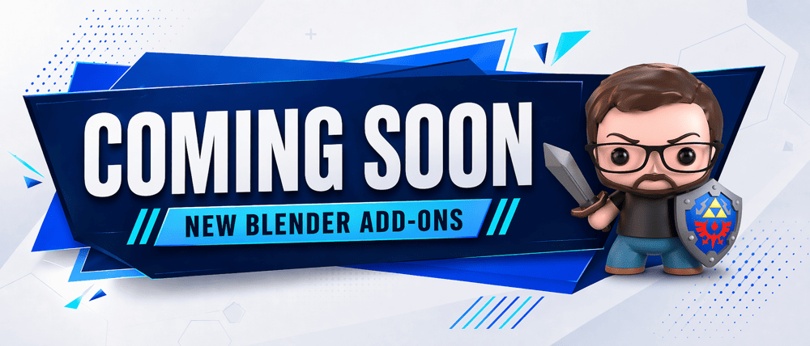
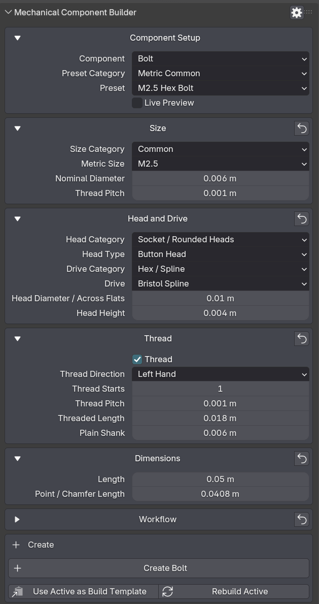

# DRH - Mechanical Component Builder

**Bolts, screws, nuts, washers, springs. Placing a beveled hex head by hand was never modeling work.**

  

 

## Where this stands

Built to v1.0.0, development paused. The user manual and changelog are already in this repository, so you can read exactly what it covers. There is no public download while it's on hold.

## What it does

Procedural, editable bolts, screws, nuts, washers, springs, rivets, studs, rings, and cutters. Hardware stays parametric, so a change in thread length or head style is a value, not a remodel.

## Who it's for

Hard-surface artists adding believable hardware to a model. Game and prop artists kitbashing machinery. Vehicle modelers who need visible fasteners that survive a close-up.

## Why it's paused

The released add-ons get the maintenance pass first. This one has the widest parameter surface of the paused tools, which means the most compatibility work before a release I'd stand behind.

[Open an issue](https://github.com/pacosalasv/DRH_Mechanical_Component_Builder-Support/issues) if you need it. Tell me the component you'd use most; that decides what gets verified first.

Docs: [user manual](docs/manual/user-manual.pdf) · [manual changelog](docs/manual/manual-changelog.md) · [CHANGELOG.md](CHANGELOG.md)

Released DRH add-ons, all free: [Blender tools on BlendKit](https://www.blendkit.com/?query=category_subtree:addon+author_id:205846) · [DRH Hub](https://github.com/pacosalasv/DRH_Addons_Hub)

  

